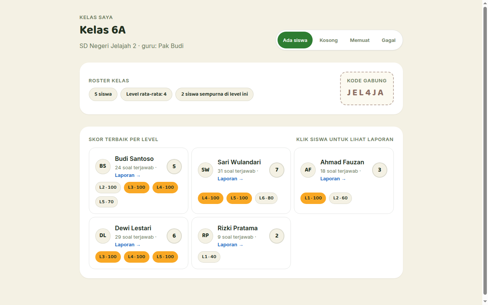
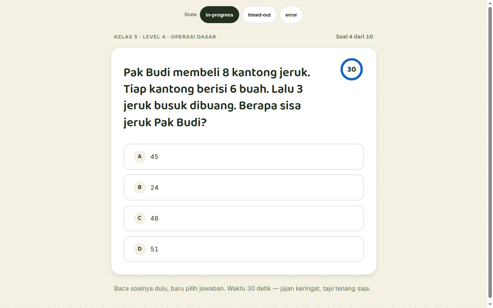
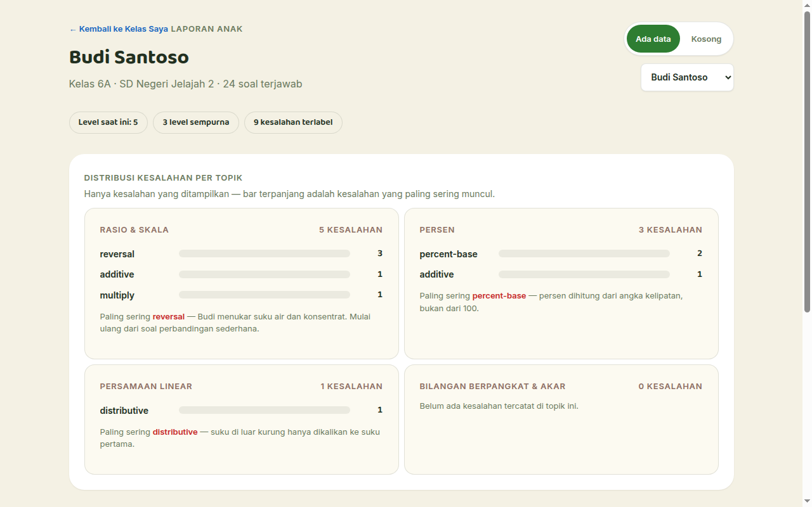

# 🧮 MathHero — Gamified Elementary Math Learning & Misconception Diagnostics

> **Interactive math education platform for elementary students (Kurikulum Merdeka Fase B & C) featuring item model generation, diagnostic misconception reporting, and Quizizz-style challenge arenas.**

---

## 📸 Visual Showcase & Diagnostic Arena

  

<em>Figure 1: Teacher Diagnostic Cockpit tracking class mastery, individual student accuracy, and concept struggle points.</em>

 

  <table width="100%">
    <tr>
      <td width="50%" align="center">
        
         <strong>Figure 2: Student Gamified Challenge Arena</strong> 
        <em>Interactive timer, combo streaks, and visual fractional/geometry manipulatives.</em>
      </td>
      <td width="50%" align="center">
        
         <strong>Figure 3: Teacher Misconception Heatmap</strong> 
        <em>Pins down whether students struggle with basic multiplication facts vs conceptual regrouping errors.</em>
      </td>
    </tr>
  </table>

