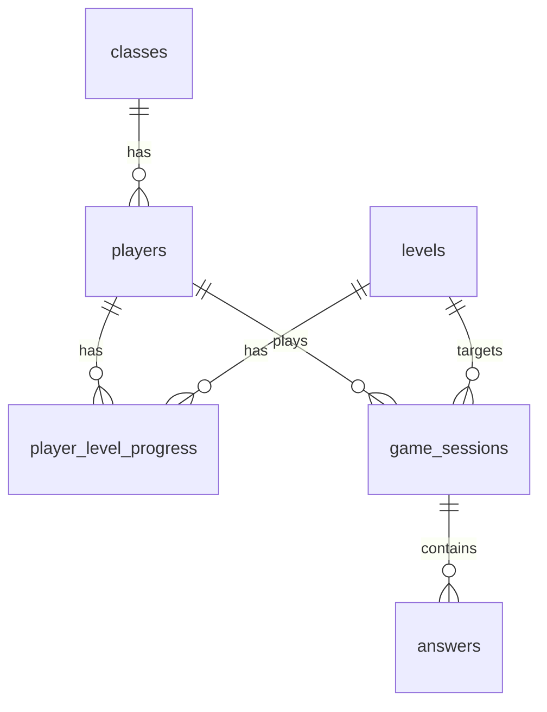

# ERD & Data Model — Math Hero

**DB:** PostgreSQL 18 · **Charset:** UTF-8 · **Engine notes:** semua PK bigint identity (PostgreSQL serial/identity)

## Tabel

### `players`
Identitas anak. **Selalu ada** (brainstorm keputusan 1: profile dulu, kelas opsional).

| Kolom | Tipe | Constraint | Catatan |
|-------|------|-----------|---------|
| `id` | bigint | PK identity | |
| `nickname` | varchar(32) | NOT NULL | unik **dalam kelas**, nullable secara global; diisi saat main pertama kali |
| `class_id` | bigint | FK → classes.id, NULL | NULL = main solo |
| `pin_hash` | varchar(255) | NULL | hash Argon2; NULL = tanpa PIN |
| `total_stars` | int | NOT NULL DEFAULT 0 | denormalisasi untuk leaderboard |
| `created_at` | timestamp | NOT NULL DEFAULT now() | |
| `updated_at` | timestamp | | |

**Invariant:** `(class_id, nickname)` UNIQUE — nickname boleh sama lintas kelas, unik dalam kelas (Quizizz-style).

### `classes`
| Kolom | Tipe | Constraint |
|-------|------|-----------|
| `id` | bigint | PK |
| `code` | char(6) | UNIQUE NOT NULL — alphabet without ambiguous chars (no O/0/I/1) |
| `name` | varchar(64) | NOT NULL |
| `grade` | smallint | NOT NULL CHECK (grade IN (4,5,6)) |
| `teacher_name` | varchar(64) | NOT NULL |
| `created_at` | timestamp | |

**Class code alphabet:** `ABCDEFGHJKLMNPQRSTUVWXYZ23456789` (32 chars, no O/0/I/1). 32^6 ≈ 1.07 miliar; collision probability pada 100 ribu kelas ≈ 0.46% per insert → **retry on collision** (3x, then error 500). Lihat AC-9.

### `levels`
| Kolom | Tipe | Constraint |
|-------|------|-----------|
| `id` | bigint | PK |
| `grade` | smallint | NOT NULL CHECK (grade IN (4,5,6)) |
| `level_number` | int | NOT NULL, UNIQUE (grade, level_number) |
| `topic_code` | varchar(64) | NOT NULL → refs curriculum.md |
| `title` | varchar(64) | NOT NULL |
| `created_at` | | |

Seed dari `docs/curriculum.md`. 30 baris (3 kelas × 10 level).

### `player_level_progress`
GATE 100% unlock: `(player_id, level_id)` unik. Satu baris per level per anak.

| Kolom | Tipe | Constraint |
|-------|------|-----------|
| `id` | bigint | PK |
| `player_id` | bigint | FK NOT NULL |
| `level_id` | bigint | FK NOT NULL |
| `best_score_pct` | int | NOT NULL DEFAULT 0 CHECK (0..100) |
| `best_time_ms` | int | NULL — hanya diisi jika best_score_pct = 100 |
|
| `attempts` | int | NOT NULL DEFAULT 0 |
| `is_unlocked` | bool | NOT NULL DEFAULT false |
| `created_at`, `updated_at` | timestamp | |

**Invariant (CHECK):** `best_score_pct = 100 OR best_time_ms IS NULL`. `is_unlocked` true hanya jika level sebelumnya (grade, level_number−1) best_score_pct=100 ATAU level_number=1.

### `game_sessions`
**Satu sesi = satu level attempt.** Keluar tengah sesi = gagal (brief rule).

| Kolom | Tipe | Constraint |
|-------|------|-----------|
| `id` | bigint | PK |
| `player_id` | bigint | FK NOT NULL |
| `level_id` | bigint | FK NOT NULL |
| `status` | text | NOT NULL CHECK IN ('active','completed','abandoned') |
| `started_at` | timestamptz | NOT NULL DEFAULT now() |
| `finished_at` | timestamptz | NULL |
| `score_pct` | int | NULL |
| `total_time_ms` | int | NULL |
| `abandon_reason` | text | NULL |

**Server-authoritative:** client gak pernah lihat `score_pct` sampai POST /answer final. Lihat spec AC-5.

### `answers`
**Satu baris per jawaban.** Ini data misconception → feed adaptive injection + report guru.

| Kolom | Tipe | Constraint |
|-------|------|----------- CHECK (chosen IS NULL OR chosen BETWEEN 0 AND 3) |
| `game_session_id` | bigint | FK NOT NULL |
| `question_index` | int | NOT NULL CHECK (0..9) |
| `question_seed` | bigint | NOT NULL — soal diregenerasi dari seed (spec AC-11) |
| `topic_code` | varchar(64) | NOT NULL |
| `chosen` | smallint | NULL — index opsi yang dipilih; NULL = timeout/haban |
| `is_correct` | bool | NOT NULL |
| `misconception_label` | varchar(64) | NULL — label dari distractor yang dipilih; NULL jika benar/timeout tanpa label |
| `time_taken_ms` | int | NULL |
| `answered_at` | timestamptz | NOT NULL DEFAULT now() |

**Index:** `(game_session_id, question_index)` UNIQUE. `(player_id, topic_code, misconception_label)` untuk adaptive query.

### `leaderboard_views`
Materialized view (refreshed on session complete): rank per (grade, week).
```sql
CREATE MATERIALIZED VIEW leaderboard_weekly AS
SELECT p.id, p.nickname, p.class_id, p.total_stars, ...
```
(T0: tabel biasa + job harian juga OK. Materialized view adalah ponytail: ceiling = real-time.)

## ERD (Mermaid)



## Generator contract (server-side, pure PHP, no I/O)

```php
interface QuestionGenerator {
    public function generate(string $topicCode, int $seed, int $difficulty): GeneratedQuestion;
}

final class GeneratedQuestion {
    public function __construct(
        public readonly string $stem,        // "3 : 1 = air : konsentrat. Ada 12 gelas air. Berapa gelas konsentrat?"
        public readonly int $answerIndex,    // 0..3, position of correct answer (shuffled by seed)
        public readonly array $options,      // 4 string, answer at answerIndex
        public readonly ?string $misconceptionLabel, // null for correct; label for the distractor logic
    ) {}
}
```

**Kontrak:**
1. `generate()` murni: argumen sama → output sama persis (deterministic by seed). Tanpa `now()`, tanpa rand().
2. **answerIndex ditentukan oleh seed** — jadi client gak bisa tau jawaban benar dari urutan opsi.
4. **answer options shuffled by seed**, sehingga jawaban benar bisa di posisi mana pun.
5. `difficulty` 0..2 mengubah rentang angka, bukan konsep. (Ponytail: difficulty adaptive per-anak = v2.)

## API surface (server-authoritative)

| Endpoint | Method | Auth | Fungsi |
|----------|--------|------|--------|
| `/api/players` | POST | none | buat profile (nickname, class_code?, pin?) |
| `/api/sessions` | POST | player token | mulai level → return session_id + 10 question seeds (TIDAK return answers) |
| `/api/sessions/{id}/answer` | POST | player token | submit jawaban 1 soal → return is_correct + correct answer (hanya ini) |
| `/api/sessions/{id}/finish` | POST | player token | tutup sesi → return score_pct, time, review wrong-answers |
| `/api/sessions/{id}/abandon` | POST | player token | tandai abandoned (progress tidak tersimpan) |
| `/api/classes` | POST | teacher pass | bikin kelas → return code |
| `/api/classes/{code}/report` | GET | teacher pass | misconception distribution per topic |
| `/api/leaderboard` | GET | none | top 50 per grade |

**Why server-authoritative (spec AC-5):** client tidak pernah menerima jawaban benar sebelum POST /answer. Timer 30s dihitung server-side dari `answered_at − (started_at + index×30s)`; client timer hanya visual. Skor dihitung di server dari `answers` table, bukan dari payload client.

## Seed → question regeneration

Soal tidak disimpan string-nya, hanya `question_seed` + `topic_code` di tabel `answers`. Review jawaban salah (AC-11) = regenerate pakai seed yang sama. Konsekuensi: **generator wajib deterministik selamanya** — itu dijamin oleh kontrak #1 + 1 unit test property-based (AC-13).
