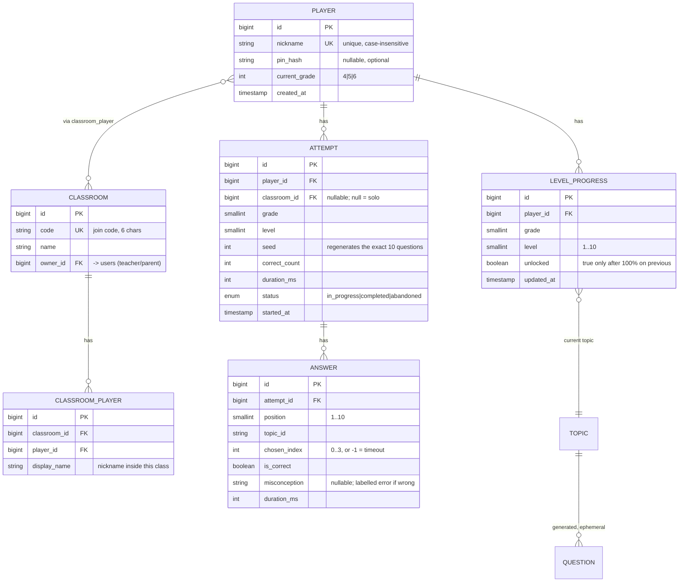

# Math Hero — Design Spec

**Tier:** T0 (portfolio, no payer, no real user data) · **Ceremony:** M · **Spec level:** spec-anchored
**Date:** 2026-09-28 · **Status:** DRAFT — pending user approval

> Spec-anchored: spec + code in the same commit; divergence blocks merge (skill `spec-drift-gate`).

## 1. Goal

A web-based interactive math game for Indonesian SD students grades 4-6 that turns
screen time into practice. Players join via nickname, play 10-question timed levels,
unlock the next level only at 100% score, and get a misconception-labelled review of
every wrong answer. Teachers/parents optionally create a class with a join code to
see per-student diagnostic reports.

**The one thing that is NOT another quiz app:** every distractor is generated from a
named, documented student misconception (Option 3 — Item Model + Misconception
Library). A wrong answer tells the teacher exactly which thinking error to re-teach.

## 2. Out of scope (deliberate exclusions)

- No game engine, no physics, no sprites. Game loop is a state machine.
- No CMS/admin panel for teachers (curriculum lives in versioned config files; the
  generator-class contract is the seam for a future panel).
- No LLM question generation (standing constraint: no OpenAI/Anthropic SDKs).
- No payments, no email, no file uploads, no mobile app, no i18n beyond Indonesian.
- No persistent "student account" with email. Identity = nickname (+ optional PIN).

## 3. Key design decisions (with reasons)

| # | Decision | Reason |
|---|----------|--------|
| D1 | Player profile always exists; a class is an **optional layer** over it | Zero-friction start for a child ("main 10 menit"); joining a class later requires no data migration. Solo and class are the same record, not two flows. |
| D2 | PIN is optional, set in settings | Friction-free by default; PIN protects a shared-device profile when the user chooses. |
| D3 | Questions generated procedurally via **Item Model + Misconception Library** | Only defensible difference from thousands of quiz clones; distractors are diagnostic, review is meaningful, content never stagnates. |
| D4 | Level = core topic + adaptive injection (~30% from weakest prior misconceptions) | Clear curriculum alignment + replayability + real remediation, from data D3 already produces. |
| D5 | Scoring is **server-authoritative** | Client-side scoring is trivially cheated and meaningless on a leaderboard; the server owns question generation, answer verification, timing, and score. |
| D6 | Curriculum = config file per grade + generator classes with a stable contract | "Never stagnates" without building a CMS now; the contract is the future seam. |
| D7 | Session-scoped game state; leaving mid-level forfeits progress | Brief's discipline rule; enforced naturally by server session, not client promises. |
| D8 | Wrong-answer review carries the misconception label | This is the product's pedagogical payoff; without labels it is decoration. |

## 4. Architecture

```
Browser (React 19 + TS, Inertia 2)
   │  Inertia page props (server-rendered, no separate REST API for pages)
   ▼
Laravel 12 (PHP 8.5)
   ├─ Http/Controllers  (thin: request → action → Inertia response)
   ├─ Actions\Game\     (StartLevel, SubmitAnswer, FinishLevel)
   ├─ Generator\        (QuestionGenerator + per-topic ItemModels)
   ├─ Generator\Misconception\  (per-topic misconception library)
   └─ Models            (Eloquent, PostgreSQL 18)
```

Layering rule: controllers contain no logic; Actions contain one use case each;
Generator is a pure, stateless, injectable service (no DB, no HTTP) — that purity is
what makes it exhaustively unit-testable.

### Interface contract (the one that must not drift)

```
QuestionGenerator::generate(TopicId $topic, int $level, int $seed): Question
Question {
    public readonly string $id;          // deterministic from topic+seed
    public readonly string $stem;        // Indonesian, e.g. "12 gelas air... berapa gelas konsentrat?"
    public readonly string $topicId;
    public readonly array $options;      // exactly 4, shuffled, one correct
    public readonly int $correctIndex;
    public readonly array $misconceptions; // 4 entries: null for the correct option,
                                           // "reversal"|"additive"|... for each distractor
}
```

The generator is **deterministic given (topic, level, seed)** — a question is
reproducible for review without storing the full question. Enforcement: a contract
test asserts `generate(t,l,s) === generate(t,l,s)`.

## 5. Data model (ERD)



Notes: `ATTEMPT.seed` + the deterministic generator reconstruct any past attempt —
the review screen regenerates questions instead of storing them. `ANSWER.misconception`
is the diagnostic signal for the adaptive injector (D4) and the teacher report.

## 6. Screen inventory

| # | id | Screen | Archetype | Primary job | States | AC |
|---|----|--------|-----------|-------------|--------|----|
| 1 | `home` | Beranda | Guided Flow | Pilih kelas atau langsung main | empty (no progress), normal | AC-1, AC-2 |
| 2 | `play` | Main | Guided Flow | Jawab 10 soal dengan timer | loading, in-progress, timeout, error | AC-3, AC-4, AC-5 |
| 3 | `results` | Hasil | Guided Flow | Lihat skor + review salah | perfect, has-wrong | AC-6, AC-7 |
| 4 | `map` | Peta Level | List-Detail | Pilih level yang terbuka | locked, unlocked, perfect | AC-8 |
| 5 | `join` | Gabung Kelas | Guided Flow | Masuk kode + nickname | error-wrong-code, error-name-taken | AC-9 |
| 6 | `classroom` | Kelas Saya | List-Detail | Lihat roster + report per anak | empty, loading, error | AC-10 |
| 7 | `report` | Laporan Anak | Executive Dashboard | Distribusi kesalahan per topik | empty, loading, error | AC-11 |

User flow: home → (join | play direct) → map → play → results → (map | review). A child
who has no class never sees screens 6-7; a teacher/parent enters via join with a
teacher-flagged account.

## 7. Acceptance criteria (EARS)

- **AC-1** WHEN a player opens the app with no profile, THE home screen SHALL show a
  nickname field and a "Main langsung" button and SHALL NOT require a class code.
  Verify: Playwright — fresh browser → type "Budi" → assert play button enabled with no code field present.
- **AC-2** WHEN a player sets a PIN in settings, THEN any later profile access on a
  new device SHALL require that PIN. Verify: unit — profile lookup with PIN set rejects
  wrong PIN; Playwright — set PIN, reopen, assert PIN prompt.
- **AC-3** WHILE a question is displayed, THE timer SHALL count down from 30 and the
  question SHALL be generated server-side; the client SHALL NOT receive the correct
  index before answering. Verify: unit — StartLevel returns questions without
  correctIndex exposed to the client payload; Playwright — inspect page props, assert
  no correct index.
- **AC-4** WHEN the 30-second timer expires with no answer, THE system SHALL record
  chosen_index = -1 and SHALL advance to the next question.
  Verify: unit — SubmitAnswer with expired deadline marks wrong, no crash.
- **AC-5** WHEN a player closes the tab mid-level and returns, THE attempt SHALL be
  marked abandoned and its progress SHALL NOT count toward level completion.
  Verify: unit — FinishLevel on abandoned attempt refuses to mark 100%.
- **AC-6** IF a completed level score is below 100%, THEN the results screen SHALL
  list each wrong question with the correct answer and the misconception label.
  Verify: Playwright — force 2 wrong via seeded generator → assert 2 review rows with labels.
- **AC-7** WHEN a player scores 100% on level N, THEN level N+1 SHALL become unlocked
  and SHALL NOT unlock before that. Verify: unit — 90% on L1 → L2 locked; 100% → unlocked.
- **AC-8** WHEN a level is locked, THE map SHALL render it non-interactive and SHALL
  show the requirement ("Selesaikan level sebelumnya dengan nilai 100%").
  Verify: Playwright — L1 not attempted → assert L2 button disabled + hint text.
- **AC-9** WHEN a player joins a class with a code and a nickname already taken in
  that class, THEN the join SHALL be rejected with a plain-Indonesian error naming the
  conflict. Verify: unit — duplicate nickname in classroom → ValidationException.
- **AC-10** WHEN a teacher views their classroom, THEN the roster SHALL show each
  player's current level and best score per level.
  Verify: unit — seed 2 players with attempts → assert both present with scores.
- **AC-11** WHEN a teacher opens a student report, THEN the screen SHALL show the
  distribution of selected misconceptions per topic, and SHALL NOT show raw scores only.
  Verify: unit — seed answers with 3 distinct misconception labels → assert all 3 present.
- **AC-12** WHEN the question generator is called twice with the same (topic, level,
  seed), THEN it SHALL return byte-identical questions and options order.
  Verify: unit — assert equality of two generate() calls, 20 random seeds × 3 topics.
- **AC-13** WHEN the generator emits a distractor, THEN that distractor SHALL differ
  from the correct answer, SHALL differ from every other distractor, and SHALL carry a
  non-null misconception label. Verify: unit — property test, 500 generated questions.

## 8. Generator design (the heart of the product)

### Item model (per topic)

A class implementing:

```php
interface ItemModel {
    public function topicId(): string;
    public function random(int $seed): QuestionSpec;   // pure, deterministic
}
```

`QuestionSpec` = { stem template + filled values, correct answer, 3 labelled
misconception applications }.

Example — ratio (grade 6, `topic.ratio`):

```
stem:    "{r1}:{r2} air:konsentrat, {w} gelas air. Berapa gelas konsentrat?"
correct: w * r2 / r1
labels:  reversal    -> w * r1 / r2        (uses the water term)
         additive    -> w + (r1 - r2)      (treats ratio as difference)
         multiply    -> w * r1 * r2        (multiplies both terms)
validate: result is a positive integer; all 4 options distinct; parallel units.
```

### Misconception library

`config/curriculum/grade-{4,5,6}.php` lists topics; each topic class carries its own
misconception set in `Generator/Misconception/`. Rules from research (vecole; Gierl):
one error per distractor; options parallel (same units/length); no "all of the above";
a distractor that no student would pick is a defect.

### Adaptive injector (D4)

For an attempt: 70% of questions from the level's core topic, 30% pulled from the
topics where this player has the most wrong answers (by misconception count). If the
player has no history, 100% core. Selection is seeded (same seed = same set).

### Curricular coverage (Kurikulum Merdeka, verified)

- Grade 4 (Fase B): operasi dasar + estimasi, pecahan sederhana, luas persegi/persegi
  panjang, satuan panjang/massa/waktu, KPK/FPB dasar.
- Grade 5: bilangan desimal + operasi, pecahan campuran + operasi, luas bangun datar
  (segitiga, jajargenjang), volume kubus/balok, sudut.
- Grade 6: rasio & skala, persen, persamaan linear satu variabel, volume bangun ruang
  kompleks (prisma/tabung), bilangan berpangkat & akar, data & grafik sederhana.

10 levels per grade are assigned from these topic pools in curriculum order.

## 9. Testing strategy

- **Generator (the masterpiece):** property-based style — AC-12/AC-13 run hundreds of
  seeded generations; assertions on distinctness, uniqueness, labelling, determinism.
  Mutation check: flip a constraint, confirm a test goes RED.
- **Actions:** unit tests per use case (AC-3..AC-5, AC-7, AC-9..AC-11).
- **Contract:** generator determinism asserted at the boundary.
- **E2E:** Playwright for the 4 player-facing gates (AC-1, AC-6, AC-8, AC-2).

## 10. Security design (T0-applicable)

- Server-authoritative scoring (D5); the client never holds correctIndex pre-answer.
- Input validation at the trust boundary: nickname format/length, join code format,
  answer payload shape and range, level/grade authorization (can't play a locked level).
- No plaintext secrets: PIN hashed (bcrypt), no API keys in client payloads.
- Rate limit level-start and answer-submit per player to prevent generator abuse.

## 11. Constitution

1. The spec is the source of truth; code and spec move together.
2. Tests precede fixes; a passing test that survives removing the fix is a defect.
3. The generator is pure and deterministic — no I/O, no hidden state.
4. Security is never simplified away at trust boundaries.
5. Boring tech wins; no new dependency without a stated reason.

## 12. Open questions resolved as rulings

- **R1** Mobile app rejected — web only (friction + server-side security is
  platform-independent).
- **R2** LLM distractor generation rejected — standing constraint against
  OpenAI/Anthropic; research also shows LLMs poorly model real student errors.
- **R3** Guest→class migration is a non-problem because profiles precede classes (D1).
- **R4** Teacher panel deferred; config + stable generator contract is the seam (D6).
